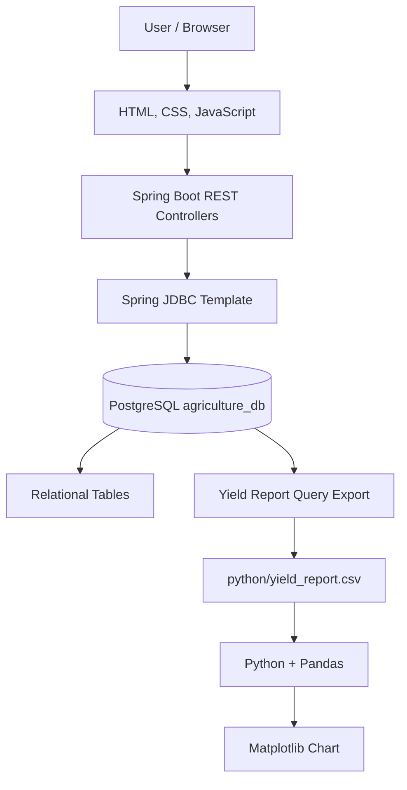
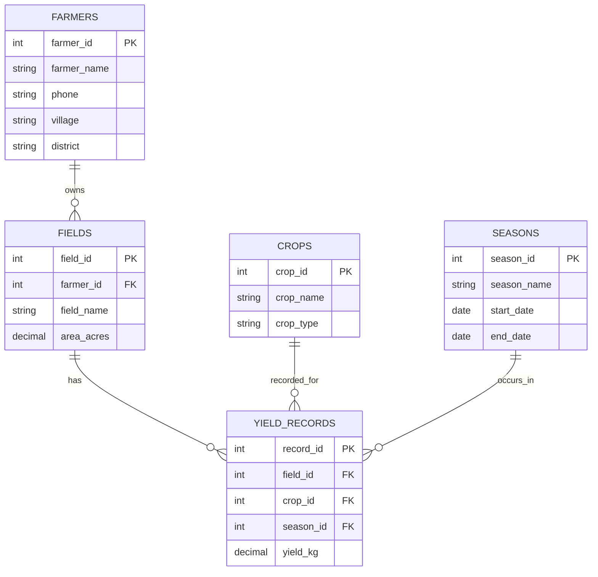
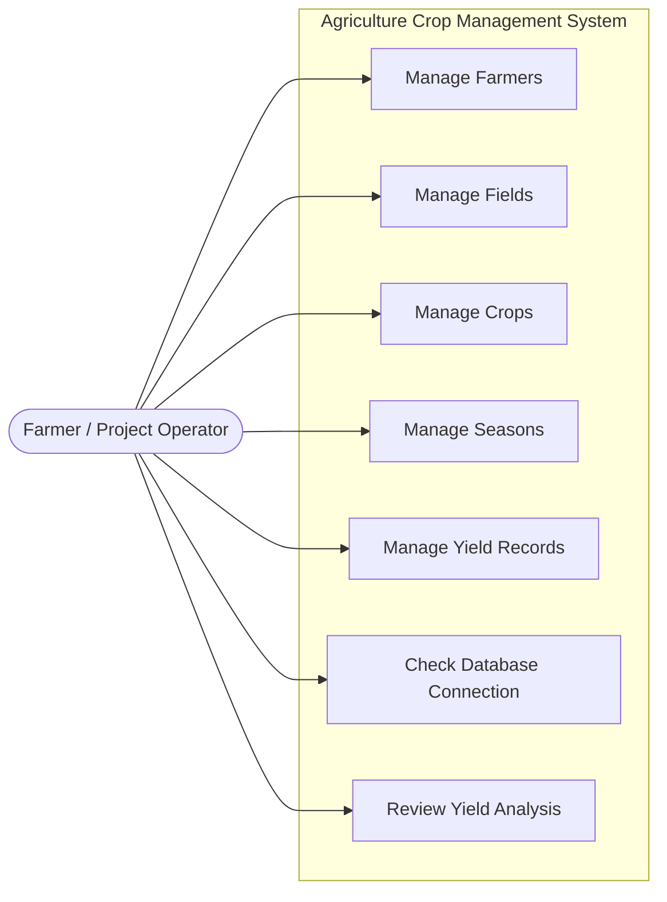
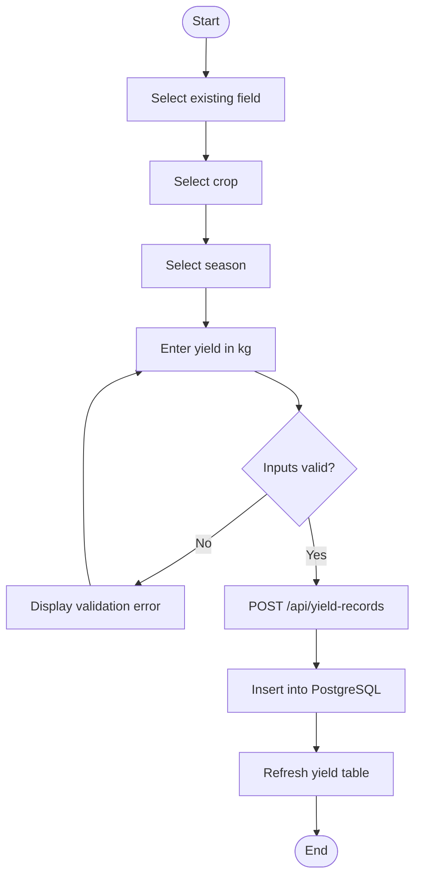
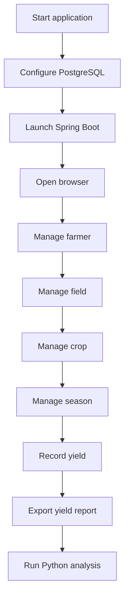
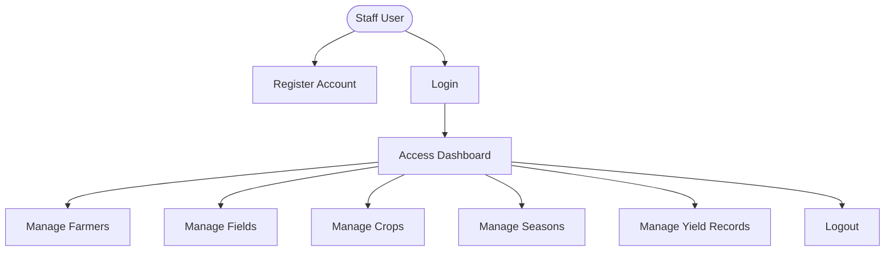
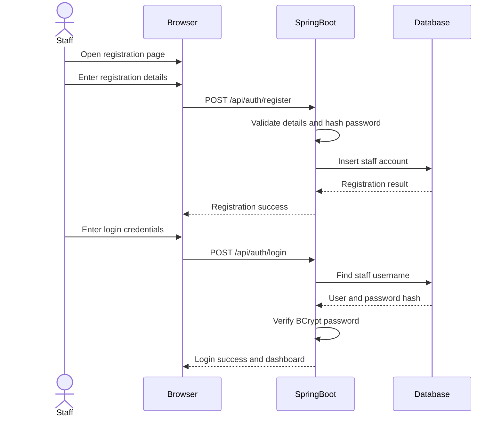

# System Diagrams

GitHub renders Mermaid diagrams embedded in Markdown. The diagrams below describe the current implementation, not proposed future features.

## 1. System architecture

## 2. Entity relationship overview

## 3. Use-case overview

## 4. Yield-record workflow

## 5. Application module sequence

---

## 6. Staff Authentication Use Case Diagram

---

## 7. Staff Registration and Login Sequence Diagram

